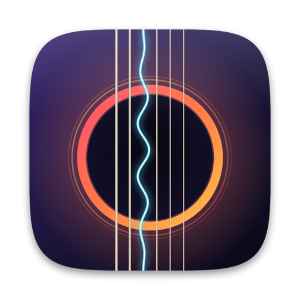

<p align="center">
  <a href="README.md">한국어</a> · <b>English</b>
</p>

<p align="center">
  
</p>

<h1 align="center">TabViewer</h1>

<p align="center">
  Guitar Pro score viewer for macOS · Playback · Editing · PDF export<br>
  <a href="https://github.com/jayusop/Tab-Viewer/releases/latest"><b>⬇ Download Latest</b></a> ·
  <a href="https://jayusop.github.io/Tab-Viewer/?lang=en">Website</a>
</p>

<p align="center">
  
  
  
  
</p>

---

A macOS app to **view, play and edit** Guitar Pro files (`.gp` `.gpx` `.gp5` `.gp4` `.gp3`). It shows standard notation and tablature together, plays back with repeats and alternate endings, and lets you write new scores or export them to PDF. Play back with the sounds built into macOS or with **Audio Unit and VST® 3 virtual instruments** installed on your Mac.

> Requirements: macOS 14 Sonoma or later (Apple Silicon / Intel) · The app's interface is in Korean.

## Installation

1. Download the file for your Mac from [Releases](https://github.com/jayusop/Tab-Viewer/releases/latest), unzip it, and move `TabViewer.app` into your **Applications** folder.

   | File | For |
   |---|---|
   | `TabViewer-Universal.zip` | Any Mac (Apple Silicon and Intel in one app — pick this if unsure) |
   | `TabViewer-AppleSilicon.zip` | Apple Silicon (M1 or later) Macs only |
   | `TabViewer-Intel.zip` | Intel Macs only |

   Check your Mac's CPU under **Apple menu › About This Mac**: **Chip** (Apple M…) or **Processor** (Intel …).
2. The first time you open it, macOS shows a security warning (this personally distributed app isn't notarized by Apple). Don't click **Move to Trash** — close it with **Done** (**Cancel** on macOS 14), then click **Open Anyway** near the bottom of **System Settings › Privacy & Security**. Or, in Terminal:
   ```bash
   xattr -dr com.apple.quarantine /Applications/TabViewer.app
   ```
3. Double-click a Guitar Pro file or drop it on the TabViewer icon. **File › Open (⌘O)** works too.

> If Guitar Pro is installed, double-clicking may open Guitar Pro instead. Right-click the file › **Open With › TabViewer**.

## Supported formats

| Format | Extension | Open | Save |
|---|---|:-:|:-:|
| Guitar Pro 7 / 8 | `.gp` | ✓ | — |
| Guitar Pro 6 | `.gpx` | ✓ | — |
| Guitar Pro 5 | `.gp5` | ✓ | ✓ |
| Guitar Pro 3 / 4 | `.gp3` `.gp4` | ✓ | — |

Edited scores are saved in Guitar Pro 5 (`.gp5`) format, using the standard structure so that other score programs that read GP5 can open them.

## Features

| Area | Features |
|---|---|
| View | Standard + TAB / TAB only / standard only, drum notation, zoom |
| Playback | Follows repeats, alternate endings (1., 2.) and tempo changes; uses the General MIDI sound bank built into macOS |
| Instruments | Built-in General MIDI, installed Audio Unit (AUv2/AUv3) and VST 3 instruments; drums stay on the built-in sounds; multitimbral (per-track MIDI channels); sync with score-playing plug-ins |
| Practice | Playback cursor & auto-scroll, click a bar to jump, speed 25%–200%, metronome, loop |
| Windows | Opening a file replaces the open score window (asks to save edited scores first); files opened together stay open together |
| Tracks | Per-track mute / solo / volume, fretboard view showing the notes being played |
| Editing | New scores (guitar, bass, 7-string, ukulele, drums), keyboard-driven entry, undo/redo |
| Structure | Add/delete tracks (name, instrument, GM sound, tuning, capo), bar settings (time & key signature, repeats, repeat count, alternate endings, section names), song info (title, artist, tempo, etc.) |
| Output | Save as PDF (current track / all tracks), print — paginated to your paper size with header and page numbers |
| Notation | Hammer-on/pull-off, slide, bend, vibrato, palm mute, let ring, harmonics, dead & ghost notes, grace notes, tremolo picking, strokes, triplets, chord names, section markers |

### Your originals stay safe

Files made in other programs are left untouched: TabViewer opens an **editable copy** in a new window, so information it can't read (RSE sound settings, lyrics, etc.) is never lost. Files saved by TabViewer can be edited directly.

## External instruments (Audio Unit / VST 3)

<p></p>

Choose the sound for playback from the **음원 (Sound)** menu in the menu bar. The choice applies to the whole app and is remembered.

| Sound | Description |
|---|---|
| Internal MIDI (General MIDI) | The GM sound bank built into macOS; each track gets its own instrument. |
| Audio Unit instruments | Third-party AU instruments (AUv2/AUv3) are found automatically. |
| VST® 3 instruments | `.vst3` instruments in `/Library/Audio/Plug-Ins/VST3` and `~/Library/Audio/Plug-Ins/VST3`. VST 2 is not supported. |

1. Pick an instrument in the **음원** (Sound) menu and its plug-in window opens. Either the VST 3 or the AU version of a plug-in works.
2. Choose a preset (sound) in the plug-in window and close it. The sound is saved; reopen the window with **음원 편집기 열기…** (Open Instrument Editor, ⌥⌘I).
3. Press Space to play. The current sound source is shown at the right of the status bar.

**Options in the Sound menu**

| Option (menu label) | Default | Description |
|---|:-:|---|
| 트랙마다 다른 MIDI 채널 사용 (멀티팀브럴, 권장) — different MIDI channel per track (multitimbral, recommended) | On | Each track gets its own channel (drums on 10); when playback starts, each channel receives the track's instrument (bank select + Program Change) and pan (CC 10). Track volume is sent as CC 7. Turn it off for single-sound plug-ins (everything goes to channel 1). |
| 드럼 트랙은 내부 음원으로 재생 — play drum tracks with the internal sounds | On | Ordinary instrument plug-ins don't follow the GM drum map, so drums use the built-in sounds. |
| 악보 재생 플러그인과 동기화 (Tablarion 등) — sync with score-playing plug-ins (e.g. Tablarion) | On | Plug-ins that play scores themselves receive **the open score itself** instead of MIDI notes and follow TabViewer's playback position and tempo (see below). |
| 플러그인 다시 검색 — rescan plug-ins | — | Refreshes the list when a newly installed plug-in doesn't appear. |

**Plug-ins that play scores themselves (e.g. Tablarion)**

> [Tablarion](https://github.com/jayusop/Tablarion) is a free plug-in by the same author as TabViewer. It plays Guitar Pro scores with its own engine and is installed separately.

- With sync on, the status bar shows "· 악보 동기화" (score sync).
- The plug-in plays with the strings, techniques and per-track instruments intact — the same sound as playing the file in the plug-in itself. Play, stop, jumps, loop and speed follow TabViewer.
- Track volume, mute and solo are applied to the plug-in's mixer when playback starts (changes during playback take effect next time).
- With sync off only MIDI notes are sent, so plug-ins that ignore MIDI channels play every track with one instrument.

**Ordinary instrument plug-ins (GM sound sets, multitimbral samplers, etc.)**
- If the plug-in has several parts, set their receive channels to 1, 2, 3…
- VST 3 plug-ins change track instruments only if they map Program Change through MIDI mapping.

**No sound?**
- Check that the sound source in the status bar is the plug-in you chose. An error window means the plug-in couldn't be loaded.
- Make sure a sound is selected in the plug-in window and the plug-in's own volume isn't at zero.
- If only track 1 is heard with an ordinary plug-in, check the MIDI channels of the plug-in's parts.
- If drums sound wrong, turn on **드럼 트랙은 내부 음원으로 재생**.

Mute/solo work on external-instrument tracks too. Plug-ins protected by iLok/PACE need iLok License Manager installed and activated.

## Keyboard shortcuts

| Action | Key |
|---|---|
| Play / Pause | Space |
| Stop | ⌘. |
| Previous / Next bar | ⌘← / ⌘→ |
| Loop | ⌘L |
| Metronome | ⇧⌘M |
| Zoom in / out | ⌘+ / ⌘- |
| New score | ⌘N |
| Edit mode | ⌘E |
| Export PDF | ⇧⌘E |
| Print | ⌘P |
| Open instrument editor | ⌥⌘I |
| Undo / Redo | ⌘Z / ⇧⌘Z |

<details>
<summary><b>Edit mode keys</b></summary>

| Key | Action |
|---|---|
| 0–9 | Enter fret on current string (two digits quickly → 10–29) |
| ← → | Previous/next beat (past the bar end → beats and bars added automatically) |
| ↑ ↓ | Move between strings |
| ⌫ | Delete note (deletes the beat if empty) |
| ↩ | Insert beat |
| + / − | Lengthen / shorten note |
| . / U / R | Dotted / triplet / rest |
| T H S B V | Tie · hammer/pull · slide · bend · vibrato |
| P L X G N | Palm mute · let ring · dead · ghost · harmonic |
| A O | Accent · staccato |

</details>

## Peace of mind

- **No internet connection**: TabViewer itself opens and saves files only on your Mac and collects no personal data. (Third-party plug-ins may connect on their own, e.g. for license activation, and with score sync on the open score is passed to the selected plug-in.)
- **Never overwrites originals**: files from other programs are edited as copies.

## Notes / limitations

- RSE (Realistic Sound Engine) sounds aren't supported. Playback uses the built-in General MIDI instruments or an installed Audio Unit or VST 3 instrument.
- The app is built without the App Sandbox so third-party plug-ins can reach their sound libraries and license files.
- Some information, such as lyrics, isn't displayed.
- Saving is supported in `.gp5` format only.
- VST 2 plug-ins are not supported (VST 3 only).
- External instrument plug-ins must contain code for the CPU TabViewer is running on. The Intel build on an Apple Silicon Mac runs under Rosetta and needs Intel (x86_64) plug-ins, so use the Universal or Apple Silicon build on Apple Silicon Macs.

## License

Freeware — **completely free for personal and business use**. No fee, registration or license key.

- Use at home or at work — companies, organisations and schools included (no limit on the number of Macs).
- Redistribute the unmodified original free of charge, together with the license.
- **The only thing not allowed is reverse engineering** — no decompiling, disassembling, or modifying/patching the binaries (except where the law says this can't be restricted by contract).
- Provided "as is" without warranty. No personal data is collected.

Full text: [LICENSE](LICENSE)

### Third-party components

| Component | In the app | License |
|---|:-:|---|
| [Steinberg VST® 3 SDK](https://github.com/steinbergmedia/vst3sdk) (hosting sources) | ✓ | MIT |
| macOS frameworks · built-in GM sound bank · Apple Symbols font | — (part of macOS) | Apple macOS license |
| Audio Unit / VST 3 plug-ins you install | — | Each maker's license |

All other code (score parsing and saving, rendering, playback engine, UI) and the app icon were written for this project; no third-party fonts, sounds or score files are included. The full MIT text of the VST 3 SDK is also shown in the app's **About TabViewer** window. Full MIT text and details: [THIRD_PARTY_NOTICES.md](THIRD_PARTY_NOTICES.md)

### Trademarks

Guitar Pro is a trademark of Arobas Music; TabViewer is an independent program not affiliated with Arobas Music. VST is a registered trademark of Steinberg Media Technologies GmbH. Apple, macOS and Audio Unit are trademarks of Apple Inc.

## Contact

- Bug reports: [Issues](https://github.com/jayusop/Tab-Viewer/issues) · jayusop@gmail.com
