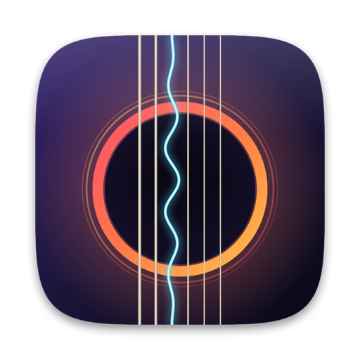

<p align="center">
  <b>한국어</b> · <a href="README.en.md">English</a>
</p>

<p align="center">
  
</p>

<h1 align="center">TabViewer</h1>

<p align="center">
  macOS용 Guitar Pro 악보 뷰어 · 재생 · 편집 · PDF 내보내기<br>
  <a href="https://github.com/jayusop/TabViewer/releases/latest"><b>⬇ 최신 버전 다운로드</b></a> ·
  <a href="https://jayusop.github.io/TabViewer/">소개 페이지</a>
</p>

<p align="center">
  
  
  
  
</p>

---

Guitar Pro 악보 파일(`.gp` `.gpx` `.gp5` `.gp4` `.gp3`)을 **보고, 듣고, 고치는** macOS 앱입니다. 표준 악보와 TAB을 함께 보여 주고, 반복 기호까지 반영해 재생하며, 새 악보를 만들거나 PDF로 내보낼 수 있습니다. 재생은 macOS 내장 음원은 물론, Mac에 설치된 **Audio Unit·VST® 3 가상악기**로도 할 수 있습니다.

> 요구 사항: macOS 14 Sonoma 이상 (Apple Silicon / Intel) · 앱 화면은 한국어입니다.

## 설치

1. [Releases](https://github.com/jayusop/TabViewer/releases/latest)에서 `TabViewer.app.zip`을 내려받아 압축을 풀고, `TabViewer.app`을 **응용 프로그램** 폴더로 옮깁니다.
2. 처음 열면 macOS가 보안 경고를 띄웁니다(Apple 공증을 받지 않은 개인 배포 앱). **휴지통으로 이동**은 누르지 말고 **완료**(macOS 14에서는 **취소**)로 창을 닫은 뒤, **시스템 설정 › 개인정보 보호 및 보안** 아래쪽의 **그래도 열기**를 클릭하세요. 터미널을 쓴다면:
   ```bash
   xattr -dr com.apple.quarantine /Applications/TabViewer.app
   ```
3. Guitar Pro 파일을 더블클릭하거나 TabViewer 아이콘 위로 끌어다 놓으면 열립니다. **파일 › 열기(⌘O)** 도 됩니다.

> Guitar Pro가 설치된 Mac에서는 더블클릭 시 Guitar Pro가 열릴 수 있습니다. 파일을 우클릭 › **다음으로 열기 › TabViewer**를 고르세요.

## 지원 형식

| 형식 | 확장자 | 열기 | 저장 |
|---|---|:-:|:-:|
| Guitar Pro 7 / 8 | `.gp` | ✓ | — |
| Guitar Pro 6 | `.gpx` | ✓ | — |
| Guitar Pro 5 | `.gp5` | ✓ | ✓ |
| Guitar Pro 3 / 4 | `.gp3` `.gp4` | ✓ | — |

편집한 악보는 Guitar Pro 5(`.gp5`) 형식으로 저장됩니다. GP5 형식을 읽는 다른 악보 프로그램에서도 열 수 있도록 표준 구조로 저장합니다.

## 기능

| 영역 | 기능 |
|---|---|
| 보기 | 표준 악보 + TAB / TAB만 / 표준 악보만, 드럼 악보, 확대·축소 |
| 재생 | 반복 기호·다른 결말(1., 2.)·템포 변화 반영, macOS 내장 GM 사운드뱅크 사용 |
| 음원 | 내장 General MIDI 음원, 설치된 Audio Unit(AUv2/AUv3)·VST 3 악기, 드럼은 내장 음원 유지, 멀티팀브럴(트랙별 MIDI 채널), 악보 재생 플러그인과 동기화 |
| 연습 | 재생 커서·자동 스크롤, 마디 클릭으로 이동, 속도 25%~200%, 메트로놈, 반복 재생 |
| 창 | 파일을 열면 기존 악보 창을 대체(수정된 악보는 먼저 저장 여부 확인), 여러 파일을 한 번에 열면 함께 열림 |
| 트랙 | 트랙별 음소거 / 솔로 / 볼륨, 현재 연주 중인 음을 보여 주는 지판 뷰 |
| 편집 | 새 악보(기타·베이스·7현·우쿨렐레·드럼), 키보드 중심 입력, 실행 취소/다시 실행 |
| 곡 구조 | 트랙 추가·삭제(이름·악기·GM 음색·튜닝·카포), 마디 설정(박자표·조표·도돌이표·반복 횟수·다른 결말·섹션 이름), 곡 정보(제목·아티스트·템포 등) |
| 출력 | PDF로 저장(현재 트랙 / 모든 트랙), 악보 인쇄 — 용지 크기에 맞춘 페이지 나눔, 머리말·쪽 번호 |
| 표기 | 해머온/풀오프, 슬라이드, 벤딩, 비브라토, 팜뮤트, let ring, 하모닉스, 데드·고스트 노트, 꾸밈음, 트레몰로 피킹, 스트로크, 셋잇단음표, 코드 이름, 섹션 마커 |

### 원본 파일 보호

다른 프로그램에서 만든 파일은 그대로 두고, 편집할 때는 **편집용 사본**을 새 창에 만듭니다. TabViewer가 읽지 못하는 정보(RSE 사운드 설정, 가사 등)가 지워지지 않도록 하기 위해서입니다. TabViewer로 저장한 파일은 바로 편집할 수 있습니다.

## 외부 음원 (Audio Unit / VST 3 악기)

<p></p>

메뉴 막대의 **음원** 메뉴에서 재생에 쓸 음원을 고릅니다. 선택은 앱 전체에 적용되고 다음 실행 때도 유지됩니다.

| 음원 | 설명 |
|---|---|
| 내부 MIDI 음원 (General MIDI) | macOS 내장 GM 사운드뱅크. 트랙마다 악기가 따로 지정됩니다. |
| Audio Unit 악기 | 설치된 서드파티 AU 악기(AUv2/AUv3)를 자동으로 찾습니다. |
| VST® 3 악기 | `/Library/Audio/Plug-Ins/VST3`, `~/Library/Audio/Plug-Ins/VST3`의 `.vst3` 악기를 찾습니다. VST 2 형식은 지원하지 않습니다. |

1. **음원** 메뉴에서 악기를 고르면 플러그인 창이 열립니다. 같은 플러그인의 VST 3·AU 버전 중 어느 쪽을 골라도 됩니다.
2. 플러그인 창에서 프리셋(음색)을 고르고 창을 닫습니다. 고른 음색은 저장되며, **음원 편집기 열기…**(⌥⌘I)로 다시 열 수 있습니다.
3. Space로 재생합니다. 상태 표시줄 오른쪽에 현재 음원 이름이 보입니다.

**음원 메뉴의 옵션**

| 옵션 | 기본 | 설명 |
|---|:-:|---|
| 트랙마다 다른 MIDI 채널 사용 (멀티팀브럴, 권장) | 켜짐 | 트랙마다 채널을 따로 쓰고(드럼은 10번), 재생을 시작할 때 채널마다 트랙의 악기(뱅크 선택 + Program Change)와 팬(CC 10)을 보냅니다. 트랙 볼륨은 CC 7로 전달됩니다. 단일 음색 플러그인이면 끄세요(모든 트랙이 채널 1로 감). |
| 드럼 트랙은 내부 음원으로 재생 | 켜짐 | 일반 악기 플러그인은 GM 드럼 배치가 아니므로 드럼은 내장 음원으로 냅니다. |
| 악보 재생 플러그인과 동기화 (Tablarion 등) | 켜짐 | 악보를 직접 연주하는 플러그인에는 MIDI 음표 대신 **열린 악보 자체**를 넘기고, TabViewer의 재생 위치·템포를 따르게 합니다(아래 참고). |
| 플러그인 다시 검색 | — | 새로 설치한 플러그인이 안 보일 때 목록을 새로 고칩니다. |

**악보를 직접 연주하는 플러그인 (Tablarion 등)**

> [Tablarion](https://github.com/jayusop/Tablarion)은 TabViewer와 같은 저작자가 무료로 배포하는 플러그인입니다. Guitar Pro 악보를 자체 엔진으로 연주하며, 별도로 설치해야 합니다.

- 동기화 옵션이 켜져 있으면 상태 표시줄에 "· 악보 동기화"가 붙습니다.
- 플러그인이 줄·주법·트랙별 악기를 살려 직접 연주하므로, 플러그인에서 파일을 직접 재생할 때와 같은 소리가 납니다. 재생·정지·이동·반복·속도는 TabViewer를 따릅니다.
- 트랙 볼륨·음소거·솔로는 재생을 시작할 때 플러그인 믹서에 반영됩니다(재생 중에 바꾸면 다음 재생부터).
- 동기화를 끄면 MIDI 음표만 보내므로, 채널을 구분하지 않는 플러그인에서는 모든 트랙이 한 악기로 연주됩니다.

**일반 악기 플러그인 (GM 음원, 멀티팀브럴 샘플러 등)**
- 플러그인이 여러 파트를 지원하면 파트마다 수신 채널을 1, 2, 3…으로 맞추세요.
- VST 3 플러그인은 Program Change를 MIDI 매핑으로 받는 경우에만 트랙 악기가 바뀝니다.

**소리가 안 날 때**
- 상태 표시줄의 음원 이름이 고른 플러그인인지 확인하세요. 오류 창이 떴다면 플러그인을 불러오지 못한 것입니다.
- 플러그인 창에서 음색이 선택되어 있는지, 플러그인 자체 볼륨이 0이 아닌지 확인하세요.
- 일반 플러그인에서 트랙 1만 들리면 플러그인 파트의 MIDI 채널 설정을 확인하세요.
- 드럼이 이상하게 들리면 **드럼 트랙은 내부 음원으로 재생**을 켜세요.

외부 악기 트랙에서도 음소거/솔로가 동작합니다. iLok/PACE로 보호되는 플러그인은 iLok License Manager가 설치·인증되어 있어야 합니다.

## 단축키

| 동작 | 키 |
|---|---|
| 재생 / 일시정지 | Space |
| 정지 | ⌘. |
| 이전 / 다음 마디 | ⌘← / ⌘→ |
| 반복 재생 | ⌘L |
| 메트로놈 | ⇧⌘M |
| 확대 / 축소 | ⌘+ / ⌘- |
| 새 악보 | ⌘N |
| 편집 모드 | ⌘E |
| PDF로 내보내기 | ⇧⌘E |
| 악보 인쇄 | ⌘P |
| 음원 편집기 열기 | ⌥⌘I |
| 실행 취소 / 다시 실행 | ⌘Z / ⇧⌘Z |

<details>
<summary><b>편집 모드 키</b></summary>

| 키 | 동작 |
|---|---|
| 0–9 | 현재 줄에 프렛 입력 (빠르게 두 자리 → 10~29) |
| ← → | 이전/다음 박자 (마디 끝에서 → 박자·마디 자동 추가) |
| ↑ ↓ | 줄 이동 |
| ⌫ | 음 지우기 (빈 박자면 박자 삭제) |
| ↩ | 박자 삽입 |
| + / − | 음 길이 늘리기/줄이기 |
| . / U / R | 점음표 / 셋잇단음표 / 쉼표 |
| T H S B V | 붙임줄 · 해머/풀 · 슬라이드 · 벤딩 · 비브라토 |
| P L X G N | 팜뮤트 · Let Ring · 데드 · 고스트 · 하모닉스 |
| A O | 악센트 · 스타카토 |

</details>

## 안심하고 쓰세요

- **인터넷에 연결하지 않습니다**: TabViewer 자체는 파일을 내 Mac 안에서만 열고 저장하며, 개인정보를 수집하지 않습니다. (외부 플러그인은 라이선스 인증 등으로 각자 연결할 수 있으며, 악보 동기화를 켜면 열린 악보가 선택한 플러그인에 전달됩니다.)
- **원본을 덮어쓰지 않습니다**: 다른 프로그램에서 만든 파일은 사본으로 편집합니다.

## 참고 / 제한

- RSE(Realistic Sound Engine) 사운드는 지원하지 않습니다. 재생은 macOS 내장 General MIDI 음색이나 설치된 Audio Unit·VST 3 악기로 합니다.
- 서드파티 플러그인이 자기 사운드 라이브러리와 라이선스 파일에 접근할 수 있도록 App Sandbox 없이 빌드됩니다.
- 가사 등 일부 정보는 표시하지 않습니다.
- 저장은 `.gp5` 형식만 지원합니다.
- VST 2 형식 플러그인은 지원하지 않습니다(VST 3만).

## 라이선스

**개인·기업 모두 완전 무료**인 프리웨어입니다. 요금, 등록, 라이선스 키가 필요 없습니다.

- 개인·가정은 물론 회사·기관·학교 등 업무용·상업적 사용 모두 가능합니다 (대수 제한 없음).
- 수정하지 않은 원본을 라이선스와 함께 무료로 재배포할 수 있습니다.
- **유일하게 금지되는 것은 리버스 엔지니어링입니다** — 디컴파일·디스어셈블, 실행 파일 수정·패치 금지 (법이 계약으로 제한할 수 없다고 정한 범위는 예외).
- "있는 그대로" 제공되며 어떠한 보증도 하지 않습니다. 개인정보를 수집하지 않습니다.

전문: [LICENSE](LICENSE) (영어 원문) · [LICENSE.ko.md](LICENSE.ko.md) (한국어 번역)

### 제3자 구성요소

| 구성요소 | 앱에 포함 | 라이선스 |
|---|:-:|---|
| [Steinberg VST® 3 SDK](https://github.com/steinbergmedia/vst3sdk) (호스팅 소스) | ✓ | MIT |
| macOS 프레임워크 · 내장 GM 사운드뱅크 · Apple Symbols 글꼴 | — (macOS의 일부) | Apple macOS 라이선스 |
| 사용자가 설치한 Audio Unit / VST 3 플러그인 | — | 각 제조사의 라이선스 |

그 밖의 코드(악보 파서·저장, 렌더링, 재생 엔진, UI)와 앱 아이콘은 이 프로젝트에서 새로 작성했으며, 서드파티 글꼴·음원·악보 파일은 들어 있지 않습니다. VST 3 SDK의 MIT 라이선스 전문은 앱의 **TabViewer 정보** 창에서도 볼 수 있습니다. MIT 라이선스 전문과 자세한 내용: [THIRD_PARTY_NOTICES.md](THIRD_PARTY_NOTICES.md) · [한국어](THIRD_PARTY_NOTICES.ko.md)

### 상표

Guitar Pro는 Arobas Music의 상표이며, TabViewer는 Arobas Music과 관련이 없는 독립 프로그램입니다. VST is a registered trademark of Steinberg Media Technologies GmbH. Apple, macOS, Audio Unit은 Apple Inc.의 상표입니다.

## 문의

- 버그 신고: [Issues](https://github.com/jayusop/TabViewer/issues) · 메일 jayusop@gmail.com
